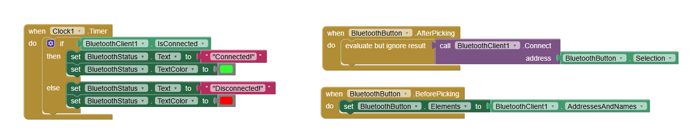
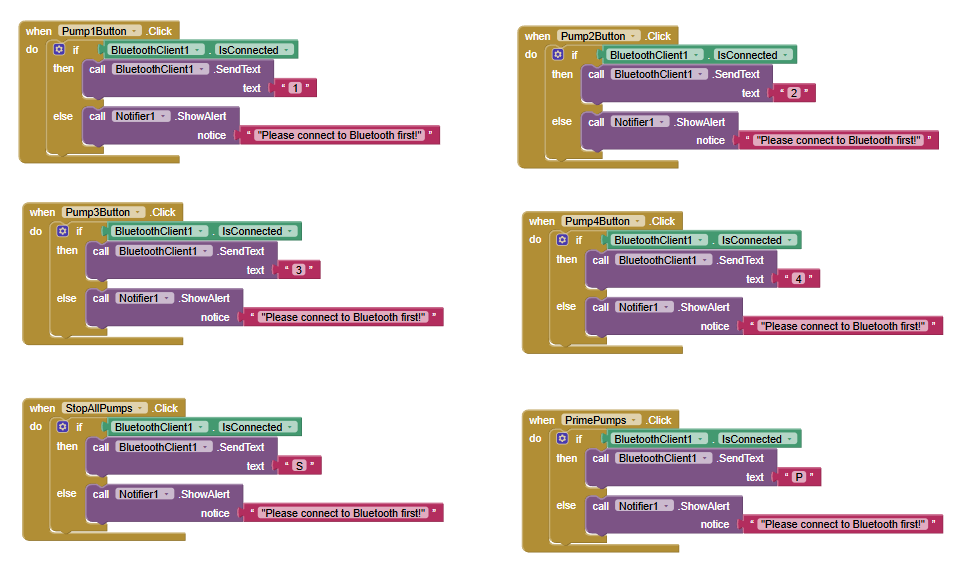
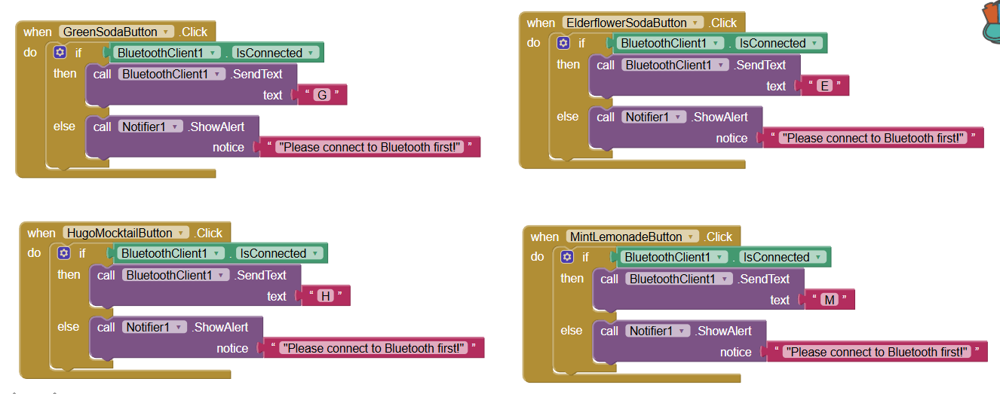
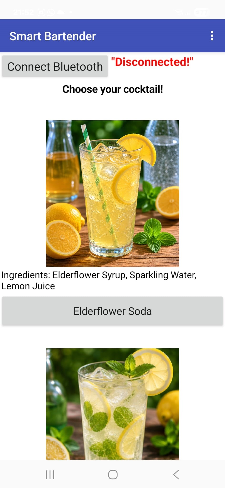
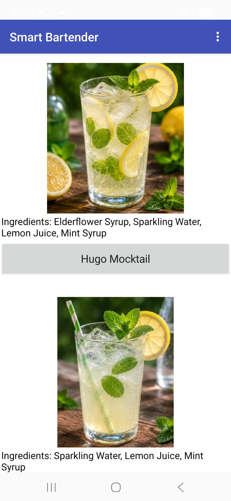
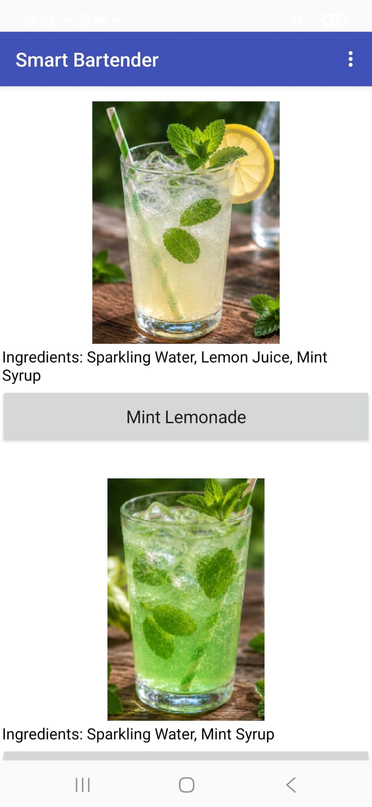
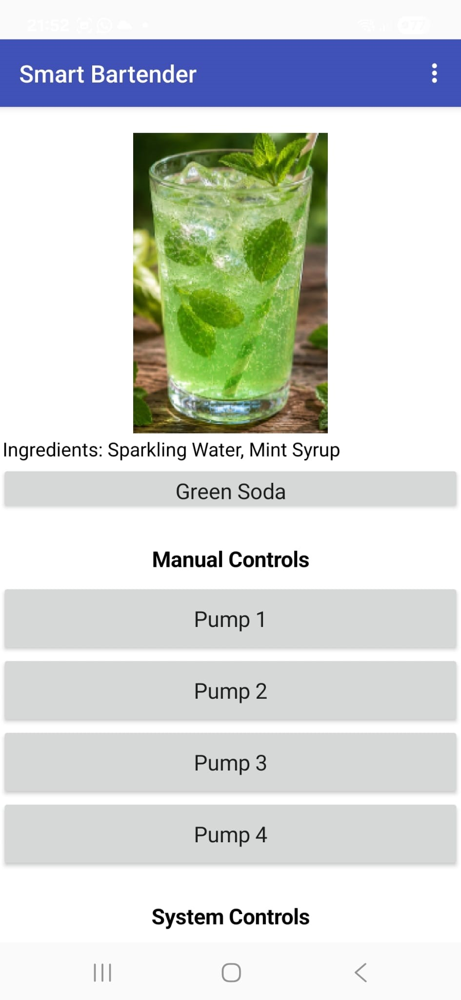
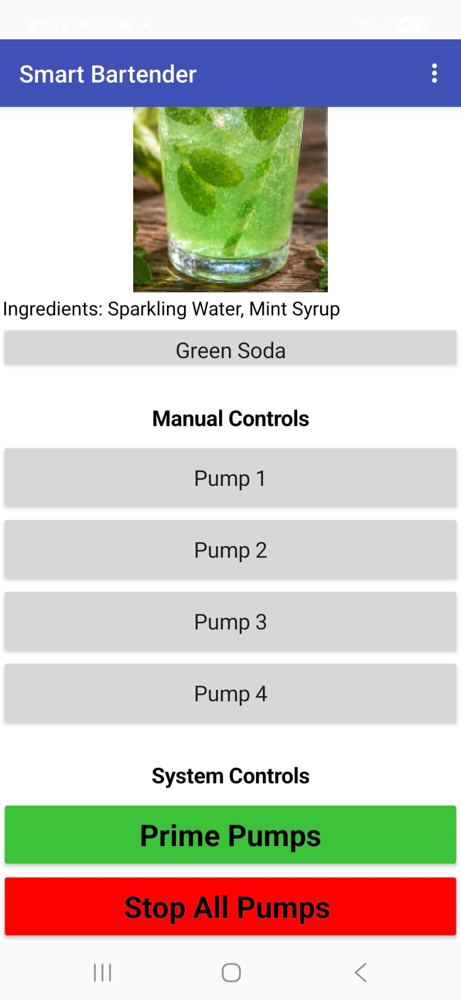
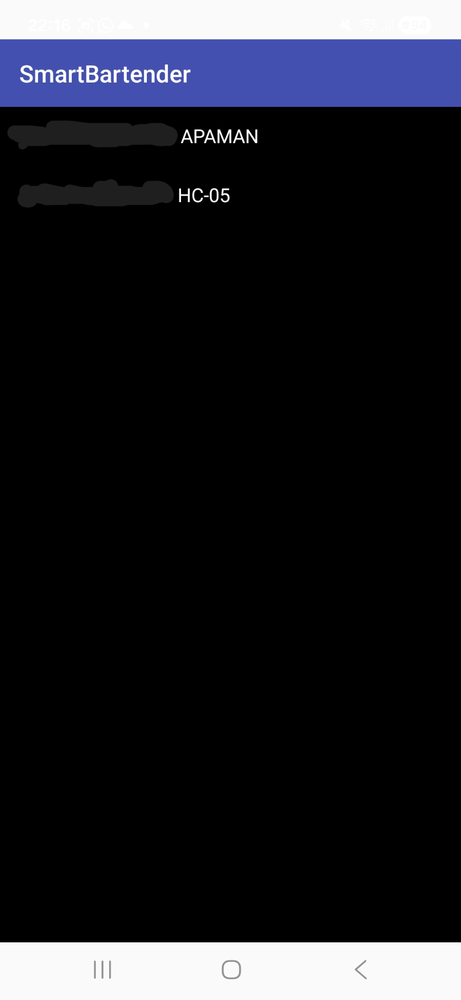

# 🍹 Smart Bartender


> An IoT-based automated cocktail preparation system combining Arduino embedded control, Bluetooth communication, an MIT App Inventor mobile application, ultrasonic glass detection, and automated ingredient dispensing.

## 📖 Overview

This project implements `Smart Bartender`, an IoT-based automated cocktail preparation system developed as a semester project for the `Internet of Things (IoT)` course.

The system combines an `Arduino Uno` embedded controller, an `HC-05 Bluetooth` module, an `MIT App Inventor` Android application, an `HC-SR04 ultrasonic sensor`, and automated pumps for ingredient dispensing. The user selects a beverage from the mobile application, which sends a command wirelessly to the Arduino. The Arduino interprets the received command and activates the corresponding pumps according to the selected recipe.

The system also includes ultrasonic glass detection as a safety mechanism. Before preparing a beverage, the Arduino checks whether a glass is present in the serving area. If the measured distance is greater than `15 cm`, the preparation is cancelled and the pumps are not activated. The project demonstrates the integration of embedded systems, wireless communication, sensors, actuators, and mobile software into a functional IoT system.

## 📚 Original Assignment

The project was developed as a semester IoT project focused on designing and implementing a functional connected system combining hardware and software components.

The initial project planning required the team to define:

- The project idea and its real-world purpose
- The generic theme addressed by the project
- The main software functionalities
- The hardware components required to build the proposed system

The final Smart Bartender system integrates these elements into an automated cocktail preparation platform controlled through a mobile application.

The project also included individual contributions from each team member. This repository currently documents my individual software contribution, which focused on the digital technologies used in the system, including embedded programming, Bluetooth communication, the MIT App Inventor mobile application, automated pump control, and ultrasonic glass detection.

## ✨ Features

- 🍹 **Automated Cocktail Preparation**
  - Automatic preparation of predefined cocktails
  - Ingredient quantities controlled through pump activation times
  - Consistent dosing based on predefined recipes
  - Support for multiple cocktail recipes

- 📱 **Mobile Application Control**
  - Android application developed using MIT App Inventor
  - Simple and intuitive graphical interface
  - Cocktail selection directly from the mobile application
  - Display of cocktail names and ingredients
  - Real-time control of the Smart Bartender system

- 📡 **Wireless Bluetooth Communication**
  - Wireless communication between the mobile application and Arduino Uno
  - HC-05 Bluetooth module used for data transmission
  - Commands transmitted as individual characters
  - Automatic Bluetooth connection status verification

- ⚙️ **Embedded System Control**
  - Arduino Uno used as the central microcontroller
  - Embedded program developed using Arduino IDE
  - Automated control of the pumps according to the selected recipe
  - Manual control of individual pumps
  - `Prime Pumps` function for filling the liquid tubes
  - `Stop All Pumps` function for stopping all pumps

- 💧 **Automated Pump Control and Dosing**
  - Four pumps assigned to different ingredients
  - Pump activation controlled according to recipe-specific durations
  - PWM-based pump control through motor drivers
  - Support for both automatic and manual pump operation

- 🥛 **Ultrasonic Glass Detection**
  - HC-SR04 ultrasonic sensor used to detect the presence of the glass
  - Distance measurement performed before cocktail preparation
  - Automatic cancellation of preparation when no glass is detected
  - Prevents liquid waste and accidental spilling

- 🛠️ **Debugging and Monitoring**
  - Arduino IDE Serial Monitor used during development
  - Real-time monitoring of received Bluetooth commands
  - Monitoring of pump activation and deactivation
  - Verification and debugging of system operation

## 🏗️ System Architecture

The following diagram illustrates the high-level architecture of the Smart Bartender system.

```text
                         ┌──────────────────────┐
                         │    Mobile App        │
                         │   MIT App Inventor   │
                         └──────────┬───────────┘
                                    │
                              Bluetooth HC-05
                                    │
                                    ▼
                         ┌──────────────────────┐
                         │      Arduino Uno     │
                         │   Central Controller │
                         └───────┬────────┬─────┘
                                 │        │
                  ┌──────────────┘        └──────────────┐
                  │                                      │
                  ▼                                      ▼
        ┌───────────────────┐                  ┌──────────────────┐
        │   HC-SR04 Sensor  │                  │   L298N Drivers  │
        │  Glass Detection  │                  │   Pump Control   │
        └─────────┬─────────┘                  └────────┬─────────┘
                  │                                     │
                  │                                     ▼
                  │                           ┌──────────────────┐
                  │                           │   4× Diaphragm   │
                  │                           │      Pumps       │
                  │                           └────────┬─────────┘
                  │                                    │
                  │                                    ▼
                  │                           ┌──────────────────┐
                  │                           │     Cocktail     │
                  │                           │    Ingredients   │
                  │                           └────────┬─────────┘
                  │                                    │
                  └───────────────┐                    ▼
                                  │             ┌───────────────┐
                                  └────────────►│     Glass     │
                                                │   / Cocktail  │
                                                └───────────────┘
```

## 📂 Project Structure

```text
SmartBartender/
├── README.md
│
├── Arduino/
│   └── SmartBartender/
│       └── SmartBartender.ino
│
├── Images/
│   ├── 01-bluetooth-connection-status-blocks.png
│   ├── 02-manual-pump-control-system-functions.png
│   ├── 03-cocktail-command-transmission-blocks.png
│   ├── 04-main-screen-available-drinks-01.jpg
│   ├── 04-main-screen-available-drinks-02.png
│   ├── 04-main-screen-available-drinks-03.png
│   ├── 04-main-screen-available-drinks-04.jpg
│   ├── 04-main-screen-available-drinks-05.jpg
│   ├── 04-main-screen-available-drinks-06.jpg
│   └── 05-bluetooth-hc-05-selection.png
│
└── MIT App Inventor/
    └── SmartBartender.aia
```

## 🛠️ Built With

- Arduino IDE
- C/C++ (Arduino)
- MIT App Inventor
- Bluetooth communication
- Arduino Uno
- HC-05 Bluetooth Module
- HC-SR04 Ultrasonic Sensor

## ⭐ Highlights

- Embedded system developed for Arduino Uno
- Automated cocktail preparation based on predefined recipes
- Mobile application developed using MIT App Inventor
- Wireless communication between the mobile application and Arduino through Bluetooth HC-05
- Automated control of four ingredient pumps
- Recipe-specific pump activation times for ingredient dosing
- Manual control of individual pumps
- `Prime Pumps` function for filling the liquid tubes
- `Stop All Pumps` function for stopping all pumps
- Ultrasonic glass detection using the HC-SR04 sensor
- Automatic cancellation of cocktail preparation when no glass is detected
- Bluetooth connection status verification in the mobile application
- Serial Monitor used for debugging and monitoring system operation

## 🎯 Concepts Demonstrated

- **Embedded Programming**
  The project demonstrates embedded programming on an Arduino Uno, with software developed using Arduino IDE to control the physical components of the system.

- **Mobile Application Development**
  A mobile application was developed using MIT App Inventor to provide the user interface for controlling the Smart Bartender.

- **Bluetooth Communication**
  Wireless communication is implemented between the mobile application and the Arduino Uno using an HC-05 Bluetooth module.

- **Command-Based Communication**
  Cocktail recipes and system functions are triggered through individual commands transmitted from the mobile application to the Arduino.

- **Automated Pump Control**
  The Arduino controls four pumps according to the selected cocktail recipe, with pump activation duration determining the amount of each ingredient dispensed.

- **Recipe-Based Automation**
  Predefined cocktail recipes are implemented in the embedded program, allowing the system to automatically execute the required sequence of pump activations.

- **Manual Hardware Control**
  The mobile application provides manual controls for activating individual pumps, as well as functions for priming the pumps and stopping all pumps.

- **Ultrasonic Distance Measurement**
  An HC-SR04 ultrasonic sensor is used to measure the distance to objects placed in the serving area.

- **Glass Presence Detection**
  The measured distance is used to determine whether a glass is present before starting the cocktail preparation process.

- **Safety-Based Control Logic**
  Cocktail preparation is automatically cancelled when no glass is detected, helping prevent unnecessary liquid dispensing.

- **Application State and Connection Handling**
  The MIT App Inventor application checks the Bluetooth connection status and notifies the user when the connection is not active.

- **System Debugging and Monitoring**
  Arduino IDE Serial Monitor is used to monitor received commands, pump activation, cocktail preparation sequences, and system operation during development and testing.

## 📡 Bluetooth Command Protocol

The Smart Bartender uses a simple character-based communication protocol between the MIT App Inventor application and the Arduino Uno.

| Command | Function |
|--------|----------|
| `E` | Prepare Elderflower Soda |
| `H` | Prepare Hugo Mocktail |
| `M` | Prepare Mint Lemonade |
| `G` | Prepare Green Soda |
| `P` | Prime Pumps |
| `S` | Stop All Pumps |
| `1` | Activate Pump 1 manually |
| `2` | Activate Pump 2 manually |
| `3` | Activate Pump 3 manually |
| `4` | Activate Pump 4 manually |

The Arduino receives each character through the HC-05 Bluetooth module and executes the corresponding cocktail recipe or system function.

## 📸 Screenshots

### 1. Bluetooth Connection and Status

The MIT App Inventor blocks handle the Bluetooth connection to the HC-05 module and continuously check the connection status. The application displays whether the Bluetooth connection is active or disconnected.



---

### 2. Manual Pump and System Controls

The application provides manual controls for operating the individual pumps, as well as system-level functions such as priming the pumps and stopping all pumps.



---

### 3. Cocktail Command Transmission

The MIT App Inventor blocks define the commands sent through Bluetooth when the user selects a cocktail or activates one of the system controls. Each button sends a specific command to the Smart Bartender system.



---

### 4. Smart Bartender Application Interface

The screenshots show the main interface of the Smart Bartender application, including the available cocktails, their ingredients, and the manual control section for the pumps and system functions.

<p align="center">
  
  
</p>

<p align="center">
  
  
</p>

<p align="center">
  
  
</p>

---

### 5. Bluetooth HC-05 Selection

The application displays the available Bluetooth devices and allows the user to select the HC-05 module used for communication with the Smart Bartender system.



## 🚀 Running

### 1. Upload the Arduino code

Open `Arduino/SmartBartender/SmartBartender.ino` using the Arduino IDE.

Connect the Arduino Uno to the computer and select the appropriate board and COM port.

Upload the sketch to the Arduino board.

### 2. Prepare the Smart Bartender hardware (optional)

The hardware prototype is not included in this repository. If you want to reproduce the physical Smart Bartender system, the required components must be acquired separately.

The prototype uses components such as:

- Arduino Uno
- HC-05 Bluetooth module
- HC-SR04 ultrasonic sensor
- Four pumps
- Motor/pump driver modules
- 12 V power supply
- Breadboard
- Jumper wires
- Other wiring and mechanical components required for the prototype

Make sure all components are correctly connected according to the hardware design before powering on the system.

### 3. Install the Android application

Open the `MIT App Inventor/SmartBartender.aia` project in MIT App Inventor.

Build the project as an Android application and install it on an Android device.

Enable Bluetooth on the Android device.

### 4. Connect to the HC-05 module

Open the Smart Bartender application and select the `HC-05` Bluetooth module from the list of available devices.

The application will display the Bluetooth connection status.

### 5. Control the Smart Bartender

Once the Bluetooth connection is established, the application can be used to:

- Select a cocktail.
- Send cocktail preparation commands to the Arduino.
- Control the individual pumps manually.
- Prime the pumps.
- Stop all pumps.

The selected commands are transmitted from the Android application to the Arduino through the HC-05 Bluetooth module.

## 📄 License

This project is released under the **MIT License**.

See the [LICENSE](LICENSE) file for more details.
